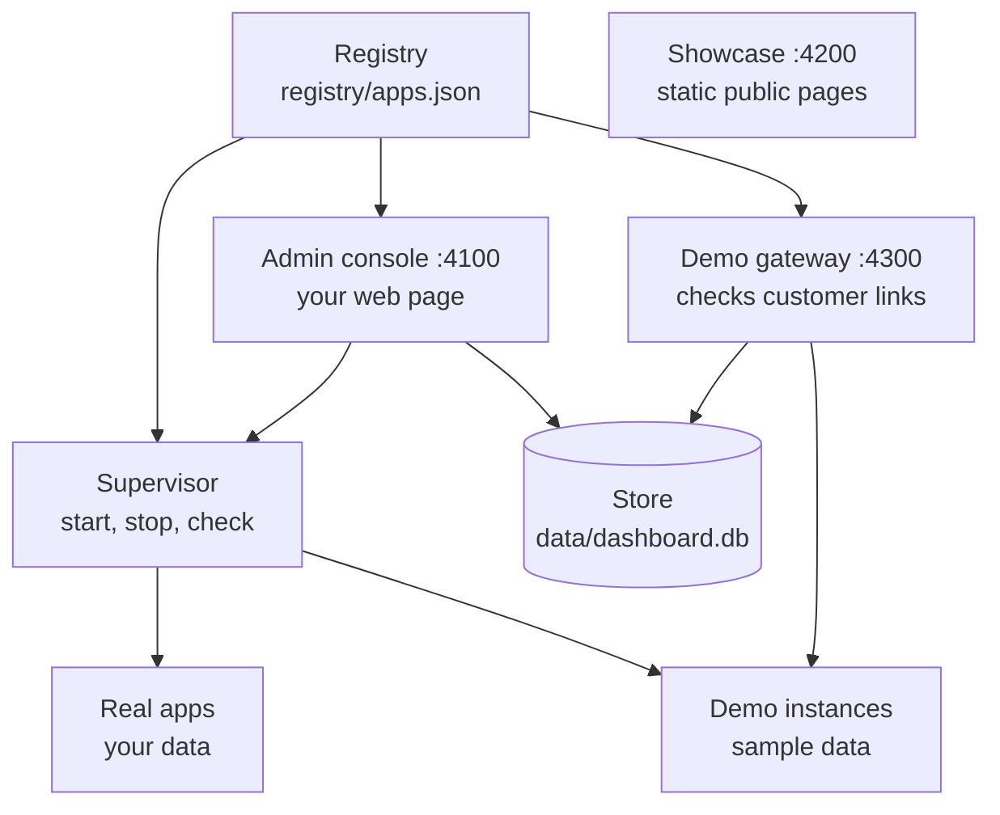

# ProjectsDashboard Handover Book

How the project works, how to run it day to day, and what to look after. Written so a new owner can pick it up without having seen it before.

> There are two copies of this book: this Markdown file (readable directly on GitHub) and [HANDOVER-BOOK.html](HANDOVER-BOOK.html) (download it and open it in a browser for the formatted version with a contents column and dark mode). When you change one, change the other.

*Repository: rigwe1965/ProjectsDashboard, branch main. Written 10 November 2026. It contains no passwords, keys or private addresses.*

## Contents

1. [What this project is](#1-what-this-project-is)
2. [The big picture](#2-the-big-picture)
3. [Getting started](#3-getting-started)
4. [The registry](#4-the-registry)
5. [The supervisor](#5-the-supervisor)
6. [The admin console](#6-the-admin-console)
7. [The demo gateway](#7-the-demo-gateway)
8. [A full example, start to finish](#8-a-full-example-start-to-finish)
9. [The public showcase](#9-the-public-showcase)
10. [Data, backups and alerts](#10-data-backups-and-alerts)
11. [Tests and automatic checks](#11-tests-and-automatic-checks)
12. [Hosting later](#12-hosting-later)
13. [Rules to keep](#13-rules-to-keep)
14. [Troubleshooting](#14-troubleshooting)
15. [Handover checklist](#15-handover-checklist)

---

## 1. What this project is

ProjectsDashboard is the control room for a set of separate apps. It starts and stops them, lets you give customers short-lived demo links, and publishes a public page for each product.

The apps themselves (CRM, ImageApp, Airfinder, ClaudeWorkspace, ClaudeOS and the Remote Management System) live in their own folders on the Desktop, each with its own settings, database and repository. The dashboard only *points at* them. It never changes them.

### The four jobs it does

| Job | Part | Who uses it |
| --- | --- | --- |
| Start, stop and watch the apps | Supervisor | You |
| Manage everything from a web page | Admin console | You only |
| Let a customer try a product for a limited time | Demo gateway | Customers |
| Show the products to the public | Showcase | Anyone |

> **The golden rule.** Never edit the apps, their `.env` files, their databases or their repositories. If something would need that, get explicit approval first.

### Words used in this book

| Word | Meaning |
| --- | --- |
| Real app | The app you use yourself, with your real data (for example CRM on port 3101). |
| Demo instance | A separate copy of an app with its own database and sample data. Customers only ever see this. |
| Link (grant) | A time-limited access ticket for one customer and one product. |
| Gateway | The doorman that checks a link and passes the customer through to the demo instance. |
| Process | One running program of an app. Some apps have two, for example an API and a user interface. |

---

## 2. The big picture

Everything reads one list of apps, the registry. The supervisor does the starting and stopping. The console and the gateway both use the supervisor and share one database.



### Ports at a glance

| Part | Port | Change with |
| --- | --- | --- |
| Admin console | 4100 | `CONSOLE_PORT` |
| Showcase preview | 4200 | `SHOWCASE_PORT` |
| Demo gateway | 4300 | `GATEWAY_PORT` |

Port 3000 is reserved because an unrelated process on the PC uses it. The dashboard never starts anything there.

---

## 3. Getting started

### What you need

- Windows with **Node.js 22 or newer** (the project uses Node's built-in SQLite).
- The apps in their Desktop folders, as listed in the registry.
- Docker Desktop, only for the Remote Management System demo (the dashboard starts it for you).

### The folders

| Folder | Holds |
| --- | --- |
| `registry/` | The list of apps (`apps.json`) and a hosted example |
| `supervisor/` | Start/stop code, backup and alert commands, demo reset helpers |
| `admin-console/` | The owner web page and its sign-in tools |
| `demo-gateway/` | The proxy, the link manager and the per-customer copy logic |
| `showcase/` | Public page content (`site.json`, `products.json`) and the builder |
| `lib/` | Shared code: storage, sign-in, backups, alerts |
| `deploy/` | Docker Compose, Caddy and app recipes for hosting later |
| `tests/`, `audits/` | Automated tests, and written security and code reviews |
| `data/` | Runtime data: database, logs, demo copies. Ignored by git. Never commit it. |

### The four double-click launchers

These are in the project root. Each one starts its service, waits until it truly answers, opens your browser, and refuses to start a second copy.

| File | Starts | Opens |
| --- | --- | --- |
| `start-console.bat` | Admin console | http://127.0.0.1:4100/ |
| `start-showcase.bat` | Builds and serves the showcase | http://127.0.0.1:4200/ |
| `start-crm.bat` | Your real CRM | http://localhost:3101/sign-in |
| `start-customer-demo.bat` | Gateway plus one chosen demo | A fresh demo link |

> **Good to know.** The console and showcase run in a minimized window; closing that window stops them. The apps and demos keep running when you close the console. Logs are in `data\logs\`.

> **One console only.** Never leave a second console running on another port. The launcher writes its output to `data\logs\console-launcher.out`, and a stray console holding that file makes the launcher wait 60 seconds and fail with no clear error.

---

## 4. The registry

The file `registry/apps.json` is the single source of truth. To add or change an app you edit this file, nothing else.

### What one entry says

```jsonc
{
  "id": "airfinder",
  "name": "Airfinder",
  "path": "${APPS_ROOT}\\Airfinder",     // where the app lives
  "processes": [{
    "name": "app",
    "cmd": "python run.py",              // how to start it
    "port": 5200,                        // the dashboard chooses the port
    "health": "/",                       // the address that proves it is alive
    "env": { "PORT": "{port}" }          // settings for this process only
  }]
}
```

- `${APPS_ROOT}` becomes the Desktop and `${DASHBOARD_ROOT}` becomes this project.
- `{port}`, `{url}` and `{port:NAME}` are filled in when the process starts.
- A process marked `optional` starts only when you ask for it with `--only=`.
- An entry with `demoOf` is a demo instance. The gateway serves it only when `demoReady` is `true`.

> **Rule.** Set `demoReady: true` only after you have confirmed the demo shares no data with the real app.

### Current entries

| App | Real ports | Demo ports |
| --- | --- | --- |
| CRM | 3101 | 3111 (plus rate limiter 3114) |
| ClaudeWorkspace | web 3102, admin 3103 | 3112, 3113 |
| Airfinder | 5200 | 5210 |
| ImageApp | 5400 | 5410 |
| ClaudeOS | api 5100, ui 8601 | ui 8611, api 5110 |
| Remote Management (RMM) | api 5300, ui 8701 | ui 8711, api 5310 |

---

## 5. The supervisor

The supervisor is the command line that controls apps. The console buttons call the same code.

```text
node supervisor/index.mjs status                    # which apps answer (read-only; also: npm run status)
node supervisor/index.mjs start   <app> [--only=proc]
node supervisor/index.mjs stop    <app> [--only=proc]
node supervisor/index.mjs restart <app> [--only=proc]
node supervisor/index.mjs reset   <demo>            # put a shared demo back to its sample data
```

### Safety built in

- It never reads or writes an app's `.env` and never writes into an app folder.
- It refuses to start a process if its port is taken or reserved, and checks every port before starting anything.
- It records the process ID of everything it starts. `stop` only ends those, and only if the start time still matches, so a reused ID is never killed. It never kills by port or by name.
- Settings for an app are given to that process only.
- Apps that need Docker (the RMM demo) get Docker Desktop started first, with a wait of up to three minutes.

Logs for each process are in `data\logs\<app>-<process>.log`. This is the first place to look when something will not start.

---

## 6. The admin console

Your web page at `http://127.0.0.1:4100/`. It listens on this PC only.

### What you see

- **App cards.** Each process with its status and buttons: Start, Stop, Restart, Open, Log.
- **Demos panel.** Create and revoke customer links, start the gateway, reset a demo's data.
- **Activity panel.** Read-only feed of sign-ins, changes, demo opens and refusals.

Closing the console never stops the apps.

### Signing in

The console has two modes. **Token mode** prints a one-time address with `?t=...` on each launch. **Password mode** is the recommended one and is what this PC uses: a password plus a 6-digit code from an authenticator app.

```text
npm run console:auth -- set-password     # choose the password
npm run console:auth -- enable-totp      # add the authenticator code
npm run console:auth -- status           # see what is set up
npm run console:auth -- sign-out-all     # end every session
npm run console:auth -- gen-key          # make an ADMIN_DATA_KEY (see below)
npm run console:auth -- disable-totp     # also: remove-password
```

Sign-in attempts are limited (8 per address and 40 overall per 15 minutes). Every sign-in, failed sign-in and credential change is written to the audit log.

### The data key

`ADMIN_DATA_KEY` is a long secret value that locks the stored 2-step secret inside the database. It lives in the console's environment, not in the project and not in backups.

> **If the key is lost.** The stored 2-step secret cannot be read. Run `disable-totp` then `enable-totp` and scan a new code. Nothing else is lost. Keep a copy of the key in a password manager.

To reach the console from another machine, `ADMIN_BIND`, `ADMIN_ALLOWED_HOSTS` and `ADMIN_SCHEME=https` must be set. It refuses to listen beyond this PC until a password exists.

---

## 7. The demo gateway

The gateway lets a customer try one product for a limited time, without ever touching your real apps.

### Creating and managing links

```text
npm run gateway                                                  # start the gateway (port 4300)
npm run demo -- create --customer "Acme Ltd" --app crm --hours 48 --max-uses 3 --device-lock
npm run demo -- list
npm run demo -- revoke <id>
```

| Option | Effect |
| --- | --- |
| `--hours N` | The link stops working after N hours (default 48) |
| `--max-uses N` | The link can be opened N times, then stops |
| `--device-lock` | Pins the link to the first browser that opens it. Deters forwarding, but is not a hard guarantee. |

### What happens when a customer opens a link

1. The link is created once and shown once. Only a hash of it is stored, so it cannot be recovered later.
2. Opening the address shows a notice and a button. Just looking at it (for example a mail scanner) does not use up a visit. The button click does.
3. The gateway checks that the link is not expired, not revoked, within its limit, and on the right device if locked.
4. The customer's browser gets a separate random session cookie. The link itself is never reused as a cookie.
5. On every request the session is checked again, so revoking or expiry applies immediately. Open live connections are re-checked every few seconds.
6. Requests go to that product's demo instance only. A link works on its own product address only.

### Two kinds of demo

| Kind | How it works | Products |
| --- | --- | --- |
| Private copy per link | Each opened link gets its own fresh copy and data. The copy is deleted when the link ends or sits unused (default 120 minutes). If all seats are taken, the customer is told so and no use is spent. | ImageApp (4 seats), Airfinder (4), ClaudeOS (3) |
| Shared demo | One instance for all customers of that product. It is reset to its sample data once every link opened for it has ended. While it resets, customers see "being prepared". | CRM, ClaudeWorkspace, Remote Management |

Customers are asked not to enter real personal data in a shared demo. Each private copy uses a few hundred MB of memory, so the seat count should fit the PC.

### Protections

- Limits on link opens per address and per link, and a temporary ban for repeated bad links.
- Strict security headers on the gateway's own pages.
- An audit entry for every create, open, refusal and revoke, including the address and browser. Customer events are kept 90 days, owner sign-ins 365 days.

Links look like `crm.localhost:4300` today, so they work on this PC only. They become public once hosting is set up (chapter 12).

---

## 8. A full example, start to finish

Follow one real scenario from a cold start to a closed demo. The names and the 8-character id are made up for illustration. The commands are the real ones.

**The story.** A prospect, Acme Ltd, asked to try the CRM. You want to give them 48 hours and at most 3 visits, check that it works, then close it.

### Step 1. Open the console

Double-click `start-console.bat`. The browser opens at `http://127.0.0.1:4100/`. Sign in with your password and the 6-digit code. You see a card for each app.

### Step 2. Make sure the demo copy is running

In the Demos panel, start the gateway and the **CRM demo**. Or from a terminal:

```text
npm run gateway
node supervisor/index.mjs start crm-demo
```

The CRM card turns green when its health address answers. Your *real* CRM (port 3101) is not involved.

### Step 3. Create Acme's link

In the Demos panel choose the customer name, the product, the hours and the options, or run:

```text
npm run demo -- create --customer "Acme Ltd" --app crm --hours 48 --max-uses 3 --device-lock

Grant a1b2c3d4 for "Acme Ltd" -> crm, expires 2026-11-12T10:00:00Z
Send this link (shown once):
  http://crm.localhost:4300/d/<long-random-token>
```

Copy the link now. It is never shown again. Send it to the customer.

### Step 4. The customer opens it

They see a short notice that this is a demo with sample data, and a button. They click it, and the CRM demo opens. They sign in with a demo user (`admin@crm.test`, `sales@crm.test` or `support@crm.test`). The shared password is the `SEED_USER_PASSWORD` value in `data/crm-demo.env`.

### Step 5. Watch what happens

Open the Activity panel in the console. You will see "link created", then "demo opened" with the customer's address and browser. A second person using the forwarded link on another browser is refused, and that shows up as a refusal.

```text
npm run demo -- list
a1b2c3d4  crm   Acme Ltd   active   until 2026-11-12T10:00:00Z  used 1/3  device-locked
```

### Step 6. Close it early

Acme has finished. Revoke the link in the Demos panel, or:

```text
npm run demo -- revoke a1b2c3d4
```

Access ends at once, even for a page that is open. Because this CRM demo is shared, the gateway resets it to its sample data after the last open link has ended, so the next customer starts clean. You can also press **Reset data** in the console.

### Step 7. Stop the demo (optional)

```text
node supervisor/index.mjs stop crm-demo
```

A demo you stop yourself is never reported as a failure by the alerts (chapter 10).

> **Shortcut.** To look at a demo yourself, double-click `start-customer-demo.bat`, choose the product from the menu, and it creates an 8-hour link for "Local owner" and opens it.

---

## 9. The public showcase

A small static website with one page per product. It has no scripts and no links to anything that runs, so it is safe to host anywhere.

### Changing it

1. Edit `showcase/site.json` for the brand and contact details.
2. Edit `showcase/products.json` for each product's text. Set `"published": false` to keep one off the site.
3. Run `npm run showcase` (or double-click `start-showcase.bat`). It builds into `showcase/dist/` and previews at http://127.0.0.1:4200/.

> **Rule.** Keep ports, folder paths and vendor internals out of the product text, and never put real credentials in it.

The style sheet is named after a fingerprint of its content (for example `style.3fa9c01b2d.css`) and cached for a year. Pages are re-checked on every visit, so changes appear straight away.

---

## 10. Data, backups and alerts

### The database

`data/dashboard.db` (SQLite) holds the process records, customer links, audit log (customer names, addresses, browsers), the admin password hash and the 2-step secret. When hosted, Postgres is used instead (`DASHBOARD_DB=postgres`).

### Backups

While the console is running, it backs up the database at start-up if the newest copy is over 20 hours old, and then every 24 hours. The 14 newest copies are kept.

| Setting | Meaning |
| --- | --- |
| `DASHBOARD_BACKUP_DIR` | Where copies go. On this PC: `D:\ProjectsDashboardBackups` |
| `DASHBOARD_BACKUP_KEEP` | How many to keep (default 14) |
| `npm run backup` | Make one copy right now |

### Restoring

1. Stop the console and the gateway.
2. Copy the chosen backup over `data/dashboard.db`.
3. Delete `data/dashboard.db-wal` and `data/dashboard.db-shm`.
4. Start again. If the 2-step code is rejected, the `ADMIN_DATA_KEY` is missing or wrong (chapter 6).

### Alerts

If `ALERT_WEBHOOK_URL` is set, the console checks every minute that the database answers and that every process the supervisor started still responds. After two failed checks in a row it sends a message, repeats it every 6 hours while the problem lasts, and sends another when it recovers.

- On this PC the address is a private ntfy topic that sends a push notification to the owner's phone. **Treat it as a secret**, because anyone who knows the topic can read it.
- Messages name apps only. Never customers, links or addresses.
- `npm run alert:test` sends a test message.
- A demo you stopped yourself is not reported. The console must be running to check, so it cannot tell you the console or the PC is off.

### Settings on this PC

These three are Windows user environment variables. They are not in the project, and they only reach programs started after they were set.

| Variable | Purpose | Keep safe? |
| --- | --- | --- |
| `ALERT_WEBHOOK_URL` | Where alerts are sent | Yes, secret |
| `DASHBOARD_BACKUP_DIR` | Backup folder on the D: drive | No |
| `ADMIN_DATA_KEY` | Locks the stored 2-step secret | Yes. Keep a copy in a password manager. |

After a console restart, `data\logs\console-launcher.out` should contain `alerts are on` and, the first time, `encrypted a stored 2-step secret`.

---

## 11. Tests and automatic checks

| Command | What it checks |
| --- | --- |
| `npm test` | Unit tests: storage, sign-in, gateway, backups, alerts, supervisor |
| `npm run lint` | Code style and common mistakes |
| `npm run test:browser` | Real Chrome: console loads, create a link, a customer opens it, revoke, sign-in and sign-out, desktop and phone layouts, the showcase |
| `npm run test:e2e` | The real demo apps end to end. Needs them running, so this PC only. |

Every push to GitHub runs a CI check with four jobs: Windows (lint, unit and browser tests), Linux (the same against Postgres and Docker builds), a secret scan, and an image scan. All four should be green before you rely on a change.

The `audits/` folder holds the written security and code reviews, with what was found and fixed.

> **Known open item.** `npm audit` reports 4 moderate warnings in a development-only tool chain (ESLint). They do not affect the running dashboard. The suggested fix is a downgrade, so it is waiting for an upstream patch.

---

## 12. Hosting later

Hosting is planned for later and is deliberately on hold. Everything works locally on SQLite with no Docker. `deploy/README.md` holds the full guide. In short:

- One Linux server running Docker Compose: Postgres, the console, the gateway, the showcase and Caddy, which gets and renews HTTPS certificates automatically.
- Three DNS names: the site, an admin name, and a wildcard for demos.
- The hosted console will not start until a password and 2-step codes are set.
- Demo apps run in locked-down containers on separate networks, with their own data.
- Recipes exist for ImageApp, Airfinder, CRM and ClaudeWorkspace. RMM and ClaudeOS are not done yet.
- Run `deploy/reset-demos.sh` on a schedule to reset shared demos.

An outside uptime check will then be useful, because the built-in alerts cannot report the PC being off.

---

## 13. Rules to keep

- Never edit the apps, their `.env` files, databases or repositories without explicit approval.
- Never mark a demo `demoReady` unless it has its own data.
- Never put real credentials in the registry or the showcase text.
- Never commit `data/`, `deploy/.env` or `registry/apps.hosted.json`.
- Keep one console running, on one port.
- The Desktop folders are the source of truth for each app. Same-named folders inside this project are old, ignored copies.
- CRM timestamps are stored as UTC without a time zone. When writing to that database directly, use `now() at time zone 'UTC'`, or sign-ins will be rejected.
- The ClaudeOS and RMM demos use the owner's Anthropic keys, so AI actions in them cost money.

---

## 14. Troubleshooting

| What you see | Likely cause and fix |
| --- | --- |
| An app will not start | Read `data\logs\<app>-<process>.log`. |
| Launcher says "already running" but the page is wrong | Another program owns the port. Run `node supervisor/index.mjs status`. |
| `start-console.bat` hangs at "Waiting for it to respond" | A stray console is holding the launcher log. Close the extra console window and try again. |
| Demo link says expired or revoked | Create a new one. Links cannot be recovered. |
| A product is missing from the demo menu | It is not `demoReady` in the registry. |
| Customer sees "All demo seats are taken" | Wait for a copy to free up, revoke an unused link, or raise `perLink.max` if the PC can cope. |
| Demo CRM says "Invalid email or password" | Use the demo password from `SEED_USER_PASSWORD` in `data/crm-demo.env`. |
| Signs in, then bounces to sign-in | A password-change time in the database is in the future (the UTC rule in chapter 13). |
| 2-step code rejected after a restore | The data key is missing or wrong. Set it again, or run `disable-totp` and `enable-totp`. |
| No alerts or backups after changing a setting | Environment variables only reach programs started afterwards. Restart the console. |
| RMM demo is slow to start | Docker Desktop is starting. Allow up to three minutes. |

---

## 15. Handover checklist

Tick these off with the new owner.

- [ ] The new owner can open the GitHub repository and run `npm install` and `npm test` successfully.
- [ ] They have signed in to the console with the password and a 2-step code.
- [ ] A copy of `ADMIN_DATA_KEY` is stored in a password manager.
- [ ] They know the alert topic is a secret, and have received a test message from `npm run alert:test`.
- [ ] The backup folder on D: contains a recent file, and they have read the restore steps (chapter 10).
- [ ] They have created, opened and revoked a demo link themselves (chapter 8).
- [ ] They have read the rules in chapter 13.
- [ ] They know where the logs are (`data\logs\`) and where the written reviews are (`audits/`).
- [ ] They know hosting is on hold and where its guide is (`deploy/README.md`).
- [ ] Housekeeping: delete the leftover test folders `pd-bat-9eea1ed5` and `pd-bat-17f15806` in the Windows temp folder.

### Where to read more

| File | Topic |
| --- | --- |
| `README.md` | Commands, backups, alerts, tests in short form |
| `docs/HOW-IT-WORKS.md` | The full explanation of how the parts fit |
| `demo-gateway/README.md` | Every gateway setting and behaviour |
| `deploy/README.md` | Hosting with Docker Compose |
